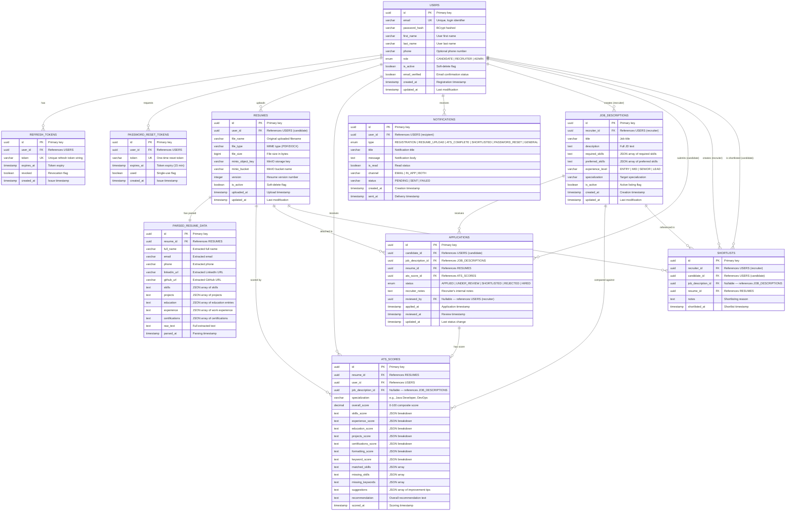

# CloudATS — Entity-Relationship Diagram

## Complete ER Diagram

---

## Schema Ownership by Service

| Schema               | Service              | Tables                                          |
|----------------------|----------------------|--------------------------------------------------|
| `auth_schema`        | Auth Service         | `users`, `refresh_tokens`, `password_reset_tokens` |
| `resume_schema`      | Resume Service       | `resumes`, `parsed_resume_data`                   |
| `scoring_schema`     | ATS Scoring Service  | `ats_scores`                                      |
| `recruiter_schema`   | Recruiter Service    | `job_descriptions`, `applications`, `shortlists`  |
| `notification_schema`| Notification Service | `notifications`                                   |
| `analytics_schema`   | Analytics Service    | Materialized views / cross-schema read access     |

---

## Key Design Decisions

1. **UUID primary keys** — No auto-increment leakage, safe for distributed systems.
2. **Schema-per-service isolation** — Each service owns its schema; cross-service data access happens via API calls, not direct DB joins.
3. **JSON fields for variable-length data** — Skills, projects, experience stored as JSON arrays in `text` columns for flexibility (PostgreSQL's `jsonb` in actual implementation).
4. **Soft deletes** — `is_active` flags instead of hard deletes for audit trails.
5. **Separate parsed data table** — Raw file in MinIO, structured data in `parsed_resume_data`, keeping concerns separated.
6. **Application lifecycle** — Full status tracking from APPLIED → HIRED with recruiter audit trail.
